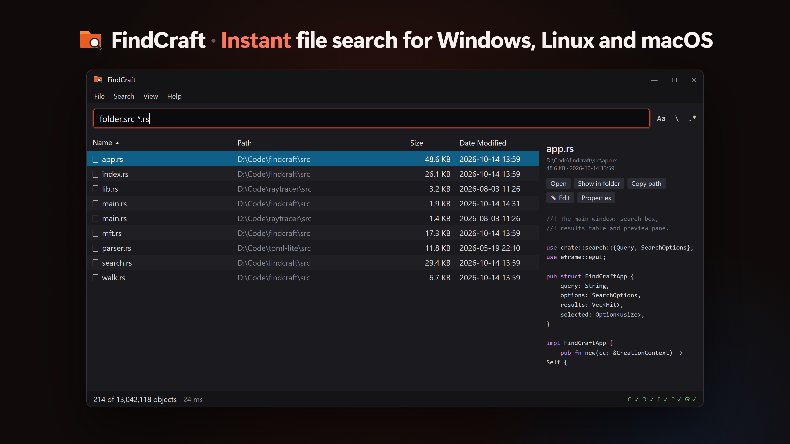

<p align="center"></p>

<h1 align="center">FindCraft</h1>

<p align="center"><strong>Find any file on your computer as fast as you can type.</strong></p>

FindCraft is a free, open-source file search app for Windows, Linux and macOS, in the spirit of
[Everything](https://www.voidtools.com/) and written in Rust. It indexes every file and folder on
your drives once, keeps the index cached, and filters millions of entries on every keystroke.

FindCraft is one of the open-source desktop apps from [Pierruno](https://pierruno.dev/).

<p align="center"></p>

## Features

- **All drives, one search box.** Results sort by name, path, size or date.
- **Fast NTFS indexing (Windows).** Turn on **⚡ Fast NTFS indexing** and a small elevated helper
  reads each drive's master file table directly, indexing a drive in seconds. The main window never
  needs administrator rights; without the helper, FindCraft uses a parallel folder scan.
- **Instant startup.** Indexes are cached on disk and refreshed in the background.
- **Everything-style queries.** Combine filters, wildcards and operators:

  | Query | Finds |
  | --- | --- |
  | `ext:pdf invoice` | PDFs with "invoice" in the name |
  | `size:>100mb` | files larger than 100 MB |
  | `dm:today` | files modified today |
  | `folder:src` | folders whose name contains `src` |
  | `report !draft` | "report" but not "draft" |
  | `jpg\|png` | either term |
  | `regex:^\d{4}-` | names matching a regular expression |

- **Preview and edit.** Text files open in an inline editor (Ctrl+S saves, keeping the encoding and
  line endings); images, hex dumps and folder listings preview too.
- **Shell actions.** Open, show in folder, Properties, copy path, open in an external editor.
- **Quick search bar (Windows).** Press **Alt+Space** anywhere for a launcher-style search box that
  ranks programs and close matches first. FindCraft keeps running in the notification area when
  its window is closed.

## Platforms

| | Windows | Linux | macOS |
| --- | :---: | :---: | :---: |
| Folder scan indexing | ✓ | ✓ (from `/`) | ✓ (from `/`) |
| Fast NTFS indexing | ✓ | | |
| Quick search bar | ✓ | | |
| Properties dialog | ✓ | | |
| Search, preview, editing | ✓ | ✓ | ✓ |

## Performance

Measured on a machine with 7 drives and 13 million files, without admin rights:

| Task | Time / size |
| --- | --- |
| Folder scan of a 4.2 M-entry SSD | 18.7 s |
| Load that drive from cache | 0.35 s |
| Typical search | 7–90 ms |
| All 13 M entries, unfiltered | 35 ms |
| Memory use | ~1.6 GB |

## Build and run

You need a recent stable [Rust toolchain](https://rustup.rs/).

**Windows**

```powershell
cargo build --release
.\target\release\FindCraft.exe
```

Click **⚡ Fast NTFS indexing** in the status bar to switch to MFT indexing (one UAC prompt for the
helper).

**Linux** needs the Wayland and xkbcommon development files (Debian/Ubuntu:
`sudo apt install pkg-config libwayland-dev libxkbcommon-dev`). **macOS** needs nothing extra.

```sh
cargo build --release
./target/release/FindCraft
```

## Documentation

- [User guide](docs/user-guide.md): the window, search syntax, editing, shortcuts and settings
- [Architecture](docs/architecture.md): index layout, MFT reader and search engine
- [Changelog](CHANGELOG.md)

## Development

Changes are committed and pushed straight to `main`, one commit per fix; no pull request or review
is needed. Force pushes to `main` and deleting it are blocked.

Run the same checks as CI before pushing:

```powershell
cargo clippy --locked --all-targets -- -D warnings
cargo test --locked
cargo deny check
```

To benchmark against a real drive:

```powershell
$env:FINDCRAFT_BENCH_ROOT = "D:\"; cargo test --release bench_real_drive -- --ignored --nocapture
```

The hero image is drawn in HTML (`promo/launch.html`, fictional data). Re-render it with Chrome or
Edge installed:

```powershell
node promo/render.mjs docs/media/findcraft-hero.png
```

CI ([`.github/workflows/ci.yml`](.github/workflows/ci.yml)) builds, lints and tests on Windows (debug
and release), Linux and macOS, and checks dependencies with `cargo deny` (policy in
[`deny.toml`](deny.toml)) and `cargo audit`. It also runs weekly so new advisories show up between
pushes. Third-party actions are pinned to commit SHAs; Dependabot keeps them and the crates in
`Cargo.lock` current.

## License

FindCraft is free software, licensed under the [GNU General Public License v3.0 or later](LICENSE).
It comes with no warranty; see [LICENSE](LICENSE) for details.
